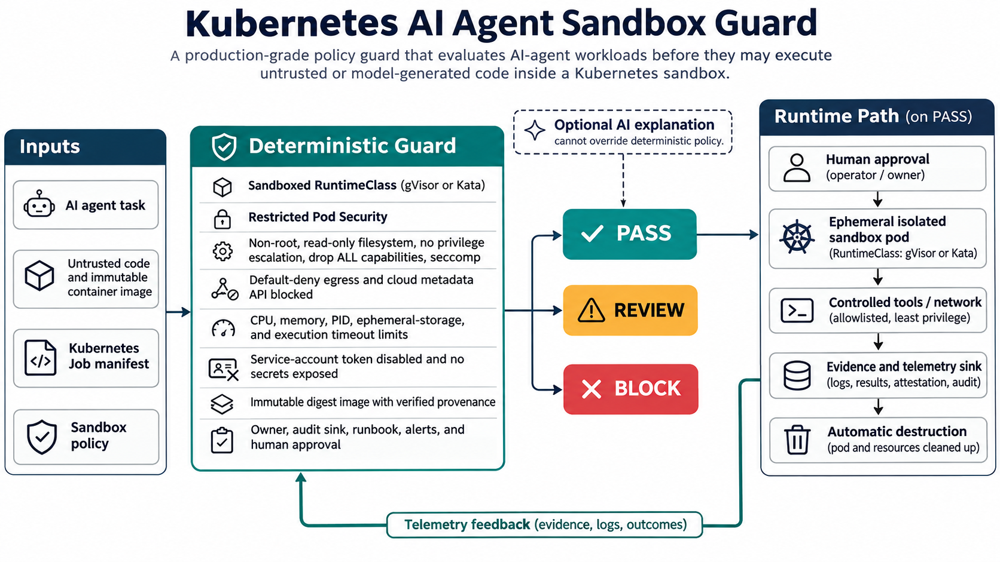

# Kubernetes AI Agent Sandbox Guard

AI agents increasingly execute model-generated code, call tools, and process untrusted artifacts. A normal container is not a security boundary strong enough for that workload in a shared cluster. This project turns sandbox requirements into a deterministic, auditable `PASS`, `REVIEW`, or `BLOCK` decision before execution.



## Why this problem matters now

Current AI-infrastructure roles repeatedly ask engineers to build safe execution environments for untrusted agent code while operating Kubernetes, network isolation, observability, and secure lifecycle controls. The implementation is grounded in current Kubernetes guidance: RuntimeClass enables alternate runtimes; multi-tenancy guidance recommends userspace kernels or virtual machines for stronger isolation; the Restricted Pod Security Standard requires non-root execution, seccomp, and dropped capabilities; and the application-security checklist calls for resource limits, dedicated service accounts, read-only filesystems, and NetworkPolicy.

The research and exact sources are recorded in [docs/research.md](docs/research.md).

## What the guard evaluates

The 16 controls cover:

- gVisor/Kata RuntimeClass selection and disabled host namespaces;
- non-root execution, read-only roots, seccomp, no privilege escalation, and all capabilities dropped;
- CPU, memory, ephemeral-storage, PID, runtime, and cleanup bounds;
- disabled service-account token automount and no secret injection;
- default-deny egress, metadata API blocking, and an explicit allowlist;
- digest-pinned images with verified provenance; and
- owner, runbook, audit sink, alert route, and human approval evidence.

Security failures block. Missing operational ownership produces `REVIEW`. Only complete evidence produces `PASS`. An optional AI explanation may summarize results, but cannot change the deterministic decision.

## Run it

```bash
python -m venv .venv
source .venv/bin/activate
pip install -e . pytest
pytest -q
agent-sandbox-guard samples/compliant-job.yaml
agent-sandbox-guard samples/unsafe-job.yaml --output json
```

The compliant sample returns `PASS | score=100.0% | 16/16 checks passed`. Non-pass decisions exit with code `2`, making the guard suitable for CI or an admission workflow.

## Architecture and operational workflow

1. The agent orchestrator produces a Kubernetes Job plus sandbox evidence.
2. CI or a platform API evaluates the bundle against versioned policy.
3. A block prevents execution; review requires an operator; pass still requires recorded human approval.
4. The approved Job runs under gVisor or Kata with least privilege and controlled network access.
5. Logs, results, and attestations flow to an evidence sink; TTL cleanup destroys the sandbox.
6. Telemetry tunes policy thresholds through review, never by allowing an LLM to override enforcement.

## Tests and measurable outcomes

The suite proves a compliant workload passes, an unsafe workload blocks, operational omissions review, and 13 individual regressions fail closed. CI runs the tests plus a real CLI evaluation.

Production evaluation criteria:

- 100% policy coverage for submitted agent sandboxes;
- 0 executions missing runtime isolation, metadata blocking, or resource bounds;
- false-positive rate below 5% after a two-week audit-only baseline;
- admission decision p95 below 250 ms;
- 100% cleanup within the declared TTL; and
- 100% of executions linked to owner, approval, audit, and runbook evidence.

## Deployment guidance

Start in CI and Kubernetes Pod Security `warn`/`audit` modes. Provision and benchmark gVisor or Kata separately, then require the guard in the platform workflow before moving to enforcement. Keep NetworkPolicy enforcement in the cluster and use admission controls for the Kubernetes-native portions; this tool is an evidence gate, not a replacement for runtime enforcement. See [docs/deployment.md](docs/deployment.md).

## Security, privacy, reliability, and failure modes

- Treat model-generated code and its outputs as hostile; never mount production secrets.
- Deny on malformed input, missing policy, unavailable provenance, or unknown RuntimeClass.
- Keep cloud metadata endpoints blocked even when limited internet egress is necessary.
- Send only policy evidence—not source code or prompts—to optional AI explanations.
- Pin CI dependencies and container digests in production; sign releases and protect policy changes.
- Account for the latency and compatibility cost of stronger runtimes; benchmark workload classes.
- Monitor admission latency, blocked-rule distribution, sandbox escape indicators, and TTL cleanup.

## Interview positioning

Use this project to discuss a real platform-security boundary: why containers alone are insufficient for untrusted agent code, how deterministic controls and stronger runtimes complement each other, why human approval remains in the workflow, and how audit-first rollout controls risk. It demonstrates Kubernetes security, AI workload operations, policy design, testing, supply-chain thinking, observability, and practical trade-off analysis for Platform, SRE, DevOps, Cloud, and AI-infrastructure roles.

## Repository map

- `src/agent_sandbox_guard/`: evaluator and CLI
- `policy/`: versioned policy limits
- `samples/`: compliant and intentionally unsafe bundles
- `tests/`: deterministic regression suite
- `docs/`: architecture, research, and deployment guidance
- `social/`: Medium, LinkedIn, and email-ready material

