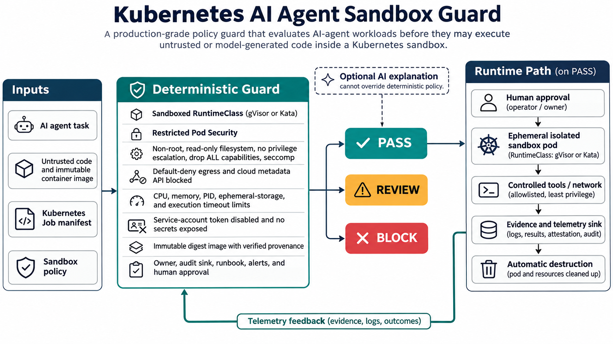

# Governing Untrusted AI-Agent Code in Kubernetes

AI agents are moving from generating text to generating and executing code. That shift creates a production problem: a useful agent task may still be hostile, buggy, resource-exhausting, or able to reach credentials and cloud metadata. A normal container is not a sufficient boundary for untrusted execution in a shared cluster.

The demand is visible in current AI-infrastructure and platform roles: teams need engineers who understand sandbox lifecycles, Kubernetes, stronger runtimes such as gVisor or Kata, network isolation, observability, and infrastructure as code. Kubernetes guidance reaches the same conclusion: sensitive multi-tenant workloads need Restricted Pod Security, seccomp, least privilege, resource bounds, NetworkPolicy, and—when appropriate—a userspace kernel or VM-backed runtime.

## The project

Kubernetes AI Agent Sandbox Guard evaluates a Job manifest and an evidence contract before code may execute. Sixteen deterministic controls produce `PASS`, `REVIEW`, or `BLOCK`. The guard checks the RuntimeClass, host namespaces, non-root execution, privilege escalation, read-only filesystems, capabilities, seccomp, compute and storage bounds, PID and time limits, service-account tokens, host access, egress, secrets, image provenance, and operational ownership.

An optional AI component may explain a decision in plain language, but it cannot change the result. That separation is intentional: probabilistic interpretation can improve usability, while security enforcement remains deterministic and testable.

## Operational workflow

The platform receives an agent task, an immutable image, a Kubernetes Job, and versioned policy. The guard evaluates the evidence in CI or a platform API. A block prevents execution. A review routes to an operator. A pass still requires recorded human approval before the Job enters an isolated gVisor or Kata sandbox. Controlled tools and allowlisted network destinations support the task; logs and attestations flow to an evidence sink; TTL cleanup destroys the workload.

## Tests and validation

The test suite proves a compliant workload passes all 16 checks, an intentionally unsafe workload blocks, missing operational evidence reviews, and 13 targeted security regressions fail closed. GitHub Actions runs the suite and a real CLI evaluation on every push and pull request.

Meaningful production measures include 100% policy coverage, zero executions without strong isolation or metadata blocking, p95 admission latency below 250 ms, less than 5% false positives after an audit baseline, and complete cleanup within the declared TTL.

## Deployment, security, and reliability

Roll out in audit mode. Benchmark sandbox-runtime compatibility and latency on a separate node pool. Enable Restricted Pod Security in warn/audit mode before enforcement. Use cluster-native admission and NetworkPolicy for runtime controls; the guard is an evidence gate, not a replacement for them.

Never expose production secrets to untrusted code. Block cloud metadata, fail closed on missing evidence, keep policy changes reviewed, and retain the manifest digest, decision, policy version, approval, and execution ID. Optional AI explanations should receive only policy evidence, not prompts or source code.

The central trade-off is performance and compatibility versus isolation. Stronger runtimes add overhead, but they materially reduce the blast radius of model-generated code. The right design makes that trade-off explicit and measurable instead of silently accepting shared-kernel risk.

## Interview positioning

This project provides a concrete discussion of platform security, Kubernetes runtime design, network isolation, supply-chain verification, policy testing, observability, and audit-first delivery. It demonstrates how to combine AI workload operations with mature Cloud, DevOps, SRE, and Platform Engineering practices.

Repository: https://github.com/ohjeffkuston/kubernetes-ai-agent-sandbox-guard

